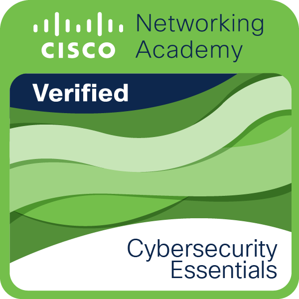
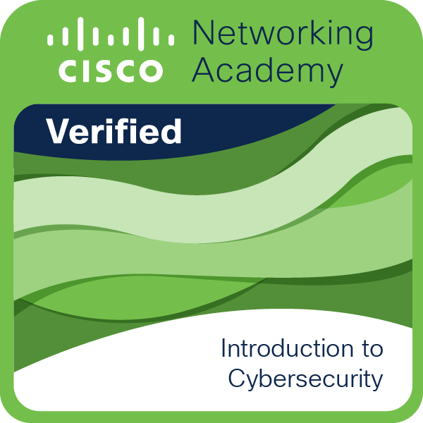
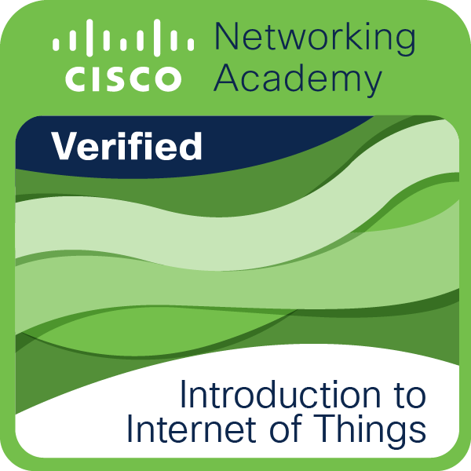
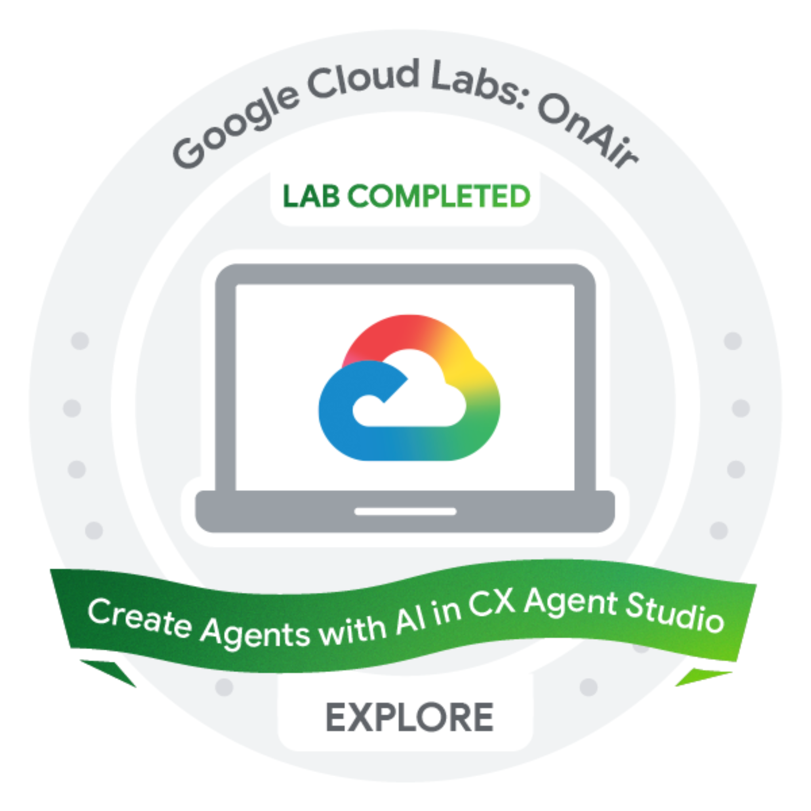
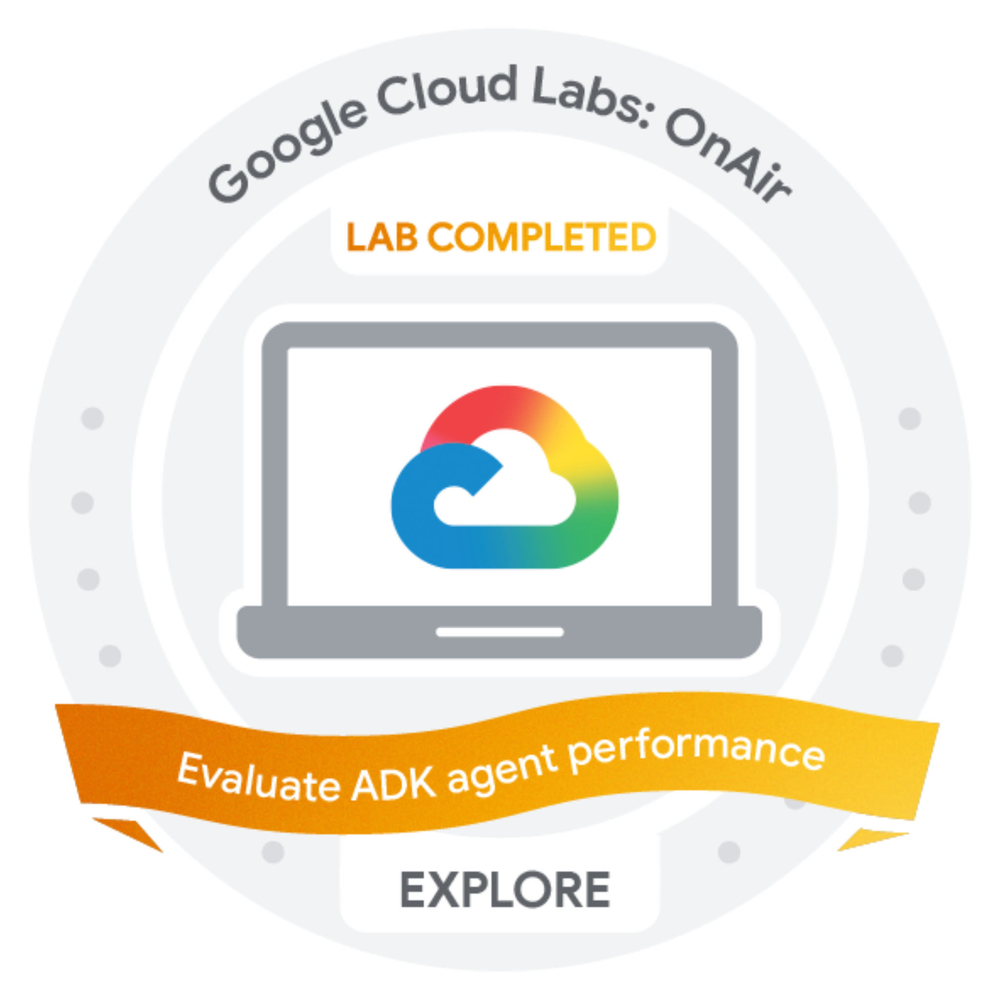
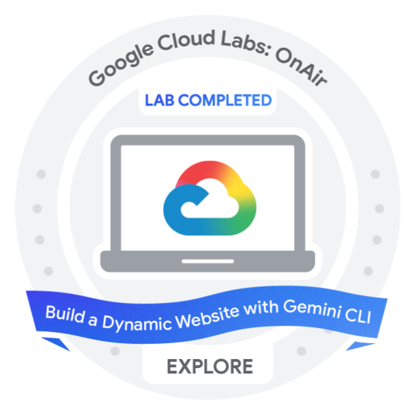
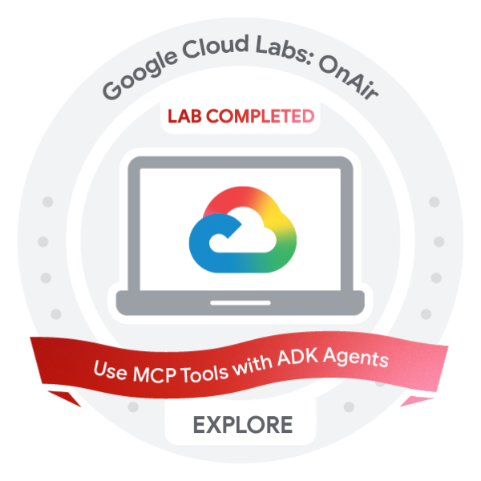
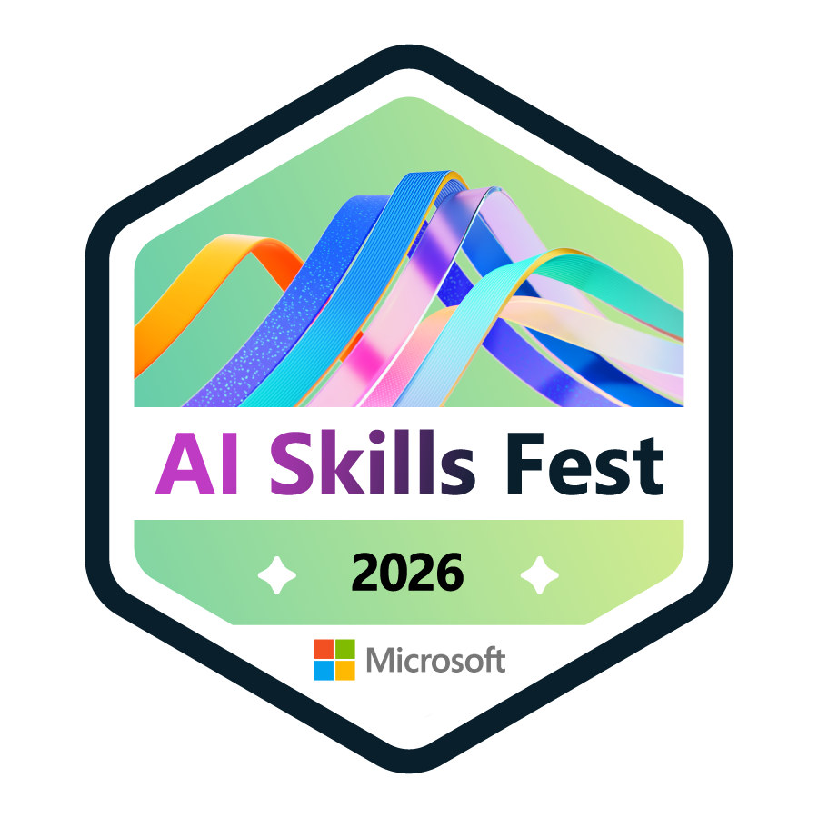
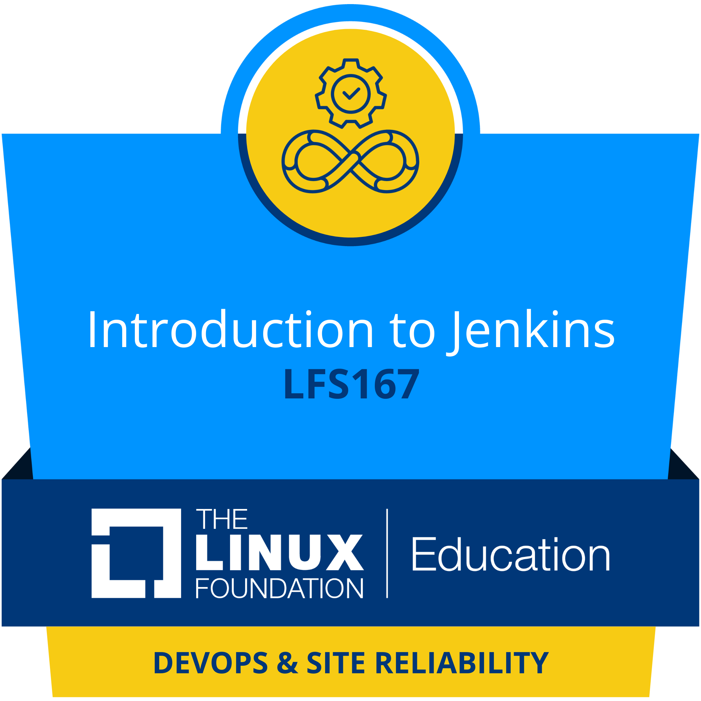

### Socials

 
<a href="https://www.github.com/HimanM" target="_blank" rel="noreferrer"> 
  <picture> <source media="(prefers-color-scheme: dark)" srcset="https://raw.githubusercontent.com/danielcranney/readme-generator/main/public/icons/socials/github-dark.svg" /> 
    <source media="(prefers-color-scheme: light)" srcset="https://raw.githubusercontent.com/danielcranney/readme-generator/main/public/icons/socials/github.svg" /> 
       
  </picture> 
</a> 
<a href="http://www.instagram.com/himanmanduja" target="_blank" rel="noreferrer"> 
  <picture> <source media="(prefers-color-scheme: dark)" srcset="https://raw.githubusercontent.com/danielcranney/readme-generator/main/public/icons/socials/instagram-dark.svg" /> 
    <source media="(prefers-color-scheme: light)" srcset="https://raw.githubusercontent.com/danielcranney/readme-generator/main/public/icons/socials/instagram.svg" /> 
       
  </picture> 
</a> 
<a href="https://www.linkedin.com/in/himanm" target="_blank" rel="noreferrer"> 
  <picture> <source media="(prefers-color-scheme: dark)" srcset="https://raw.githubusercontent.com/danielcranney/readme-generator/main/public/icons/socials/linkedin-dark.svg" /> 
    <source media="(prefers-color-scheme: light)" srcset="https://raw.githubusercontent.com/danielcranney/readme-generator/main/public/icons/socials/linkedin.svg" /> 
       
  </picture> 
</a>

### 🏅 Certifications

  
  
  
  
  
  
  
  
  
  
  
  
  
  
  
  
  

### 👷 Check out what I'm currently working on

- [HimanM/StudyDock](https://github.com/HimanM/StudyDock) - StudyDock: private Udemy question notes, focused review, and browser or desktop study exports.
- [HimanM/DropForge](https://github.com/HimanM/DropForge) - An app that allows you to AFK mine timed Twitch drops, with automatic drop claiming and channel switching.
- [HimanM/IPFamilySwitcher](https://github.com/HimanM/IPFamilySwitcher) - Per-application IPv4 and IPv6 control for Windows. Persistent executable-scoped firewall rules, built with .NET 10 and WPF.
- [HimanM/Fuck-Udemy-Exam-UI](https://github.com/HimanM/Fuck-Udemy-Exam-UI) - A Tampermonkey userscript that fixes Udemy&#39;s absolutely fucking annoying practice exam interface.
- [HimanM/MCP-Agent](https://github.com/HimanM/MCP-Agent) - Multilingual MCP-powered shopping assistant for Kapruka with chat, cart, checkout, order tracking, and voice support.
### 🌱 My latest projects

- [HimanM/StudyDock](https://github.com/HimanM/StudyDock) - StudyDock: private Udemy question notes, focused review, and browser or desktop study exports.
- [HimanM/IPFamilySwitcher](https://github.com/HimanM/IPFamilySwitcher) - Per-application IPv4 and IPv6 control for Windows. Persistent executable-scoped firewall rules, built with .NET 10 and WPF.
- [HimanM/MCP-Agent](https://github.com/HimanM/MCP-Agent) - Multilingual MCP-powered shopping assistant for Kapruka with chat, cart, checkout, order tracking, and voice support.
- [HimanM/BrokenOps](https://github.com/HimanM/BrokenOps) - An interactive, open-source DevOps and Sysadmin training platform that spins up intentionally broken VMs for hands-on troubleshooting practice. Features in-browser terminal, automated verification, and gamified progress tracking.
- [HimanM/DropForge](https://github.com/HimanM/DropForge) - An app that allows you to AFK mine timed Twitch drops, with automatic drop claiming and channel switching.
### 🔨 My recent Pull Requests

- [20.6 beta: browser-free web login, badge alerts and optional expiry skipping](https://github.com/HimanM/DropForge/pull/23) on [HimanM/DropForge](https://github.com/HimanM/DropForge)
- [Restore Twitch progress and modernize session login](https://github.com/HimanM/DropForge/pull/22) on [HimanM/DropForge](https://github.com/HimanM/DropForge)
- [Fix web campaign discovery on headless servers](https://github.com/HimanM/DropForge/pull/21) on [HimanM/DropForge](https://github.com/HimanM/DropForge)
- [Fix Twitch device login startup crash](https://github.com/HimanM/DropForge/pull/20) on [HimanM/DropForge](https://github.com/HimanM/DropForge)
- [Add priority-first idle free badge farming](https://github.com/HimanM/DropForge/pull/19) on [HimanM/DropForge](https://github.com/HimanM/DropForge)
### ⭐ Recent Stars

- [AhmadHassan-BTed/Turnitout-Humanizer](https://github.com/AhmadHassan-BTed/Turnitout-Humanizer) - FREE FOREVER, NO LIMITS 100% Programmatic, Zero-AI Plagiarism Remover &amp; Similarity Evader. Bypass Turnitin, iThenticate, GPTZero, CopyLeaks, Quillbot &amp; ZeroGPT for LaTeX, DOCX, &amp; Multi-Language Source Code.
- [Manoj-engineer/k8squest](https://github.com/Manoj-engineer/k8squest) - K8sQuest — A local, hands-on Kubernetes learning game with real-world troubleshooting challenges. Practice Pods, Deployments, Services, networking, storage, and debugging using kubectl on a local cluster (kind/k3d). No cloud required.
- [latent-spaces/brag](https://github.com/latent-spaces/brag) - You built it. Now brag. Turn the project you just created into a short, shareable launch video with one command.
- [kalkman-code/beamer](https://github.com/kalkman-code/beamer) - One keyboard and mouse for a Mac and a Windows PC over the local network, in either direction.
- [ohne-b/twitch-drops-miner](https://github.com/ohne-b/twitch-drops-miner) - a self-hosted Rust miner with a React dashboard, game selection and device-code login.
